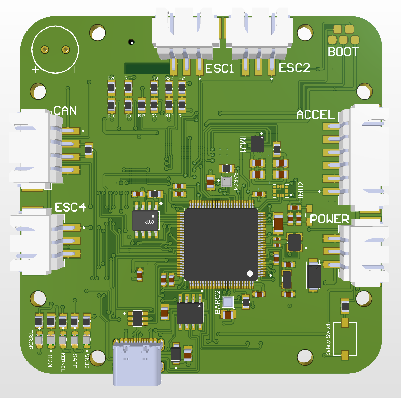
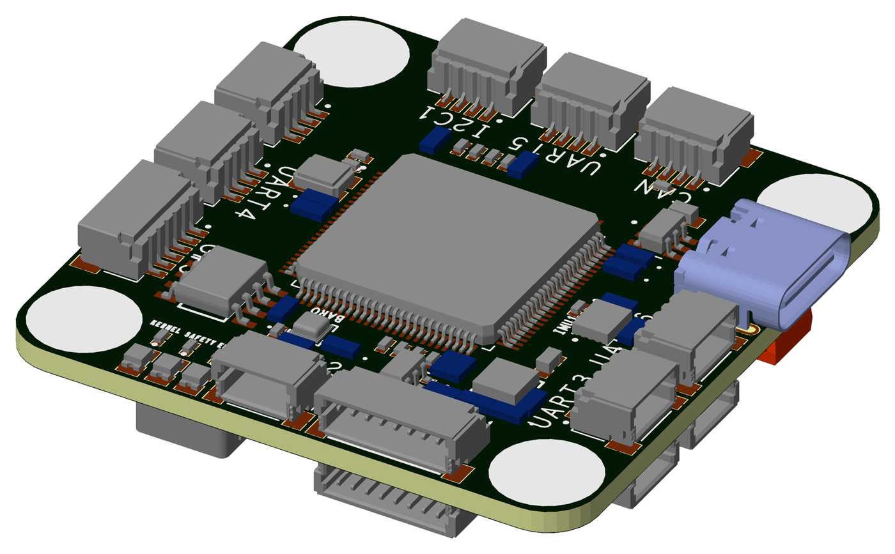

# Custom PX4 Flight Controller (FMU)

A custom flight management unit (FMU) for the **PX4 autopilot**, built around the **STM32H743VIT6** (Cortex-M7, 480 MHz).

| Revision | Board | EDA tool | Status |
|---|---|---|---|
| **Rev A** | FMU V1.0 | Altium Designer | Fabricated and brought up. Issues found are tracked in [Issues](https://github.com/Traiserdinger/Custom-PX4-Flight-Controller/issues) |
| **Rev B** | FMU V1.1 | OrCAD Capture CIS 24.1 + Allegro PCB Editor 24.1 | Layout complete, under design review (not yet fabricated) |

| Rev A (V1.0) | Rev B (V1.1) |
|---|---|
|  |  |

## What changed from Rev A to Rev B

| Block | Rev A (V1.0) | Rev B (V1.1) |
|---|---|---|
| Board | Altium, 4-layer | 40.5 × 40.5 mm, 6 layers 1.6 mm (TOP / GND / SIG / PWR / GND / BOT) |
| IMU | ICM-42688-P (SPI1) + ICM-42670-P (SPI2) | ICM-42670-P (SPI2) + BMI270 (SPI3), one SPI bus per IMU |
| Barometer | BMP390L + BMP581 (shared SPI3) | BMP581 (SPI1, shared with FRAM) |
| Magnetometer | – | HMC5883L on-board (I2C2) |
| Power input | External 5 V | TPS5430 buck from battery (3S–6S) |
| Current sense | INA219 | Analog `CURR` from the 4-in-1 ESC |
| Motor outputs | 4 + 4 AUX through SN74LVC244 buffer | 8 outputs direct from MCU (33 Ω series + USBLC6-4SC6 ESD), so bidirectional DShot works |
| Sensor rail | RT9193 always on | RT9193 enabled by MCU (`SENS_PWR_EN`) so sensors can be power-cycled |
| CAN | SN65HVD230 | TJA1051T/3 |
| Passives | 0603 | 0402 (10 µF and bulk caps stay 0603 or larger) |

## Repository structure

```
├── hardware/
│   ├── rev-a-v1.0/              Altium project (open "Trung Flight Controller.PrjPcb")
│   │   ├── *.SchDoc, *.PcbDoc
│   │   ├── Library/             Schematic and footprint libraries
│   │   └── Project Outputs .../ Gerber, NC drill, BOM and DRC reports of Rev A
│   └── rev-b-v1.1/              OrCAD/Allegro project
│       ├── schematic/           Capture design (.DSN) and project (.opj)
│       ├── pcb/                 Allegro board (.brd), 3D mapper, custom footprints
│       ├── netlist/             Allegro netlist (pstxnet/pstxprt/pstchip)
│       ├── bom/                 BOM (grouped) and part list with placement side
│       ├── reports/             DRC, unconnected/unplaced, placement, dangling, cross-section
│       └── step/                3D model of the assembled board (STEP AP214, zipped)
├── docs/
│   ├── rev-a-v1.0/              Schematic PDF and photos/renders of Rev A
│   └── rev-b-v1.1/              Schematic PDF, layer plots, 3D renders, design review
├── firmware/
│   └── rev-a-v1.0/              PX4 bootloader and firmware binaries for Rev A
├── mechanical/
│   └── 3d-printed/              3D-printed enclosure, mounts and F450 frame models
└── README.md
```

## Fabrication files

- **Rev A:** Gerber, NC drill and BOM are in [`hardware/rev-a-v1.0/Project Outputs for Trung Flight Controller/`](hardware/rev-a-v1.0/Project%20Outputs%20for%20Trung%20Flight%20Controller).
- **Rev B:** Gerber and NC drill are not published yet. The board is still being reviewed (see [design review](docs/rev-b-v1.1/REVIEW_RevB.md)).

## Opening the projects

- **Rev A:** open `hardware/rev-a-v1.0/Trung Flight Controller.PrjPcb` in Altium Designer. If 3D models are missing, check *Preferences → Data Management → File-based Libraries*.
- **Rev B:** see [`hardware/rev-b-v1.1/README.md`](hardware/rev-b-v1.1/README.md).

## License

Hardware released under [CERN-OHL-S v2](https://ohwr.org/cern_ohl_s_v2.txt).
