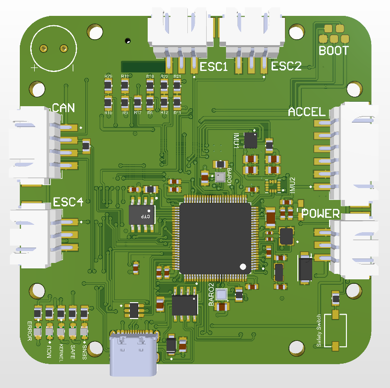

# Custom PX4 Flight Controller (FMU) – V1.0

A custom flight management unit (FMU) designed for the **PX4 autopilot**, built around the **STM32H743VIT6** (Cortex-M7, 480 MHz). Designed in **Altium Designer** with a hierarchical multi-sheet schematic, 3D-printed enclosure included.



## Highlights

| Block | Parts |
|---|---|
| MCU | STM32H743VIT6, 24 MHz HSE, 32.768 kHz LSE |
| IMU (redundant) | ICM-42688-P (SPI1), ICM-42670-P (SPI2) |
| Barometer (redundant) | BMP390L, BMP581 (SPI3) |
| Power monitor | INA219 (I2C2) |
| Storage | microSD (4-bit SDMMC), FM25V05 F-RAM (SPI2) |
| Outputs | 4× motor + 4× aux PWM, buffered by SN74LVC244 |
| RC input | FlySky i-Bus, level-shifted by SN74LVC1T45 |
| Comms | USB-C (USBLC6-2SC6 ESD), CAN (SN65HVD230), GPS, telemetry, optical flow, ROS 2 uXRCE-DDS, FPGA SPI header |
| Power | AMS1117-3.3 (MCU rail), RT9193-3.3 low-noise LDO (sensor rail), SMAJ5.0A TVS |
| Misc | Safety switch, buzzer, status LEDs, SWD pads |

## Repository structure

```
├── hardware/          Altium project (open Trung Flight Controller.PrjPcb)
│   ├── *.SchDoc       Schematic sheets: FMU, Sensor, SD, PWM, Connector
│   ├── *.PcbDoc       PCB layout
│   ├── Library/       Schematic & footprint libraries
│   └── 3D Body/       STEP models for 3D view
├── mechanical/        3D-printed enclosure (Bambu Studio .3mf)
├── docs/
│   ├── schematic_v1.0.pdf
│   └── images/
└── README.md
```

Gerber and NC drill files are published under **Releases**, not in the source tree.

## Status

- **V1.0**: schematic, layout and fabrication done; hardware bring-up revealed issues listed in [Issues](../../issues).
- **V1.1**: in progress.

## Opening the project

1. Clone the repo.
2. Open `hardware/Trung Flight Controller.PrjPcb` in Altium Designer.
3. If 3D models are missing, check *Preferences → Data Management → File-based Libraries*.

## License

Hardware released under [CERN-OHL-S v2](https://ohwr.org/cern_ohl_s_v2.txt).
