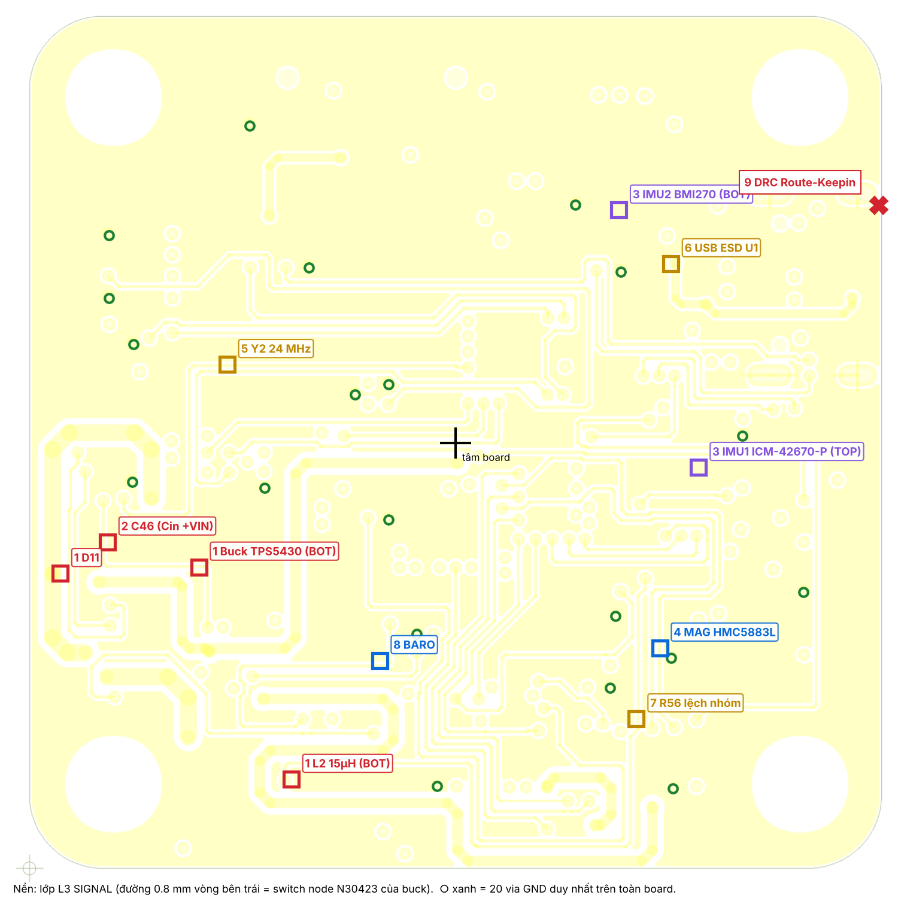

# Đánh giá thiết kế FMU V1.1 – Rev B (schematic + layout)

*Ngày review: 2026-11-20. Người review: Claude (AI), theo yêu cầu của chủ dự án.*

**Nguồn dữ liệu (đều nằm trong repo):**

| Dữ liệu | File |
|---|---|
| Schematic (7 sheet, xuất từ Capture CIS 24.1) | [`FMU_V1.1_RevB_Schematic.pdf`](FMU_V1.1_RevB_Schematic.pdf) |
| Netlist Allegro (PSTWRITER, 2026-11-18) | [`hardware/rev-b-v1.1/netlist/`](../../hardware/rev-b-v1.1/netlist) |
| Board | [`hardware/rev-b-v1.1/pcb/FMU_V1.1_RevB.brd`](../../hardware/rev-b-v1.1/pcb/FMU_V1.1_RevB.brd) (Allegro 24.1, lưu 2026-11-20) |
| Report Allegro (DRC, unconnected, unplaced, placed, dangling, cross-section, shape) | [`hardware/rev-b-v1.1/reports/`](../../hardware/rev-b-v1.1/reports) |
| Ảnh từng layer, 3D | [`layers/`](layers), [`3d/`](3d) |

Mức độ: **[CRITICAL]** board không chạy hoặc có nguy cơ hỏng · **[MAJOR]** sai chức năng hoặc kém tin cậy · **[MINOR]** tối ưu, best practice.
Mỗi mục có: vị trí (sheet / designator / pin / net), lý do, cách sửa, cách kiểm chứng. Pinout và giá trị lấy từ netlist; chỗ nào cần datasheet thì ghi rõ.

---

## 1. Tóm tắt

| Hạng mục | Kết quả |
|---|---|
| Kích thước | 40.5 × 40.5 mm, 6 lớp 1.6 mm (TOP / GND / SIGNAL / POWER / GND / BOTTOM, 1 oz) |
| Linh kiện | 151 trong netlist, 150 đã đặt (57 TOP, 93 BOT) + 4 lỗ bắt vít, **C56 chưa đặt** |
| Route | **0 unconnected pin pair**, 124 net |
| DRC | **1 lỗi** (Shape to Route Keepin, SIGNAL, (40.40, 31.55)) |
| Via | 210 via 0.3/0.35 mm (through), trong đó **chỉ 20 via GND** cho 143 pin GND |
| Dangling | 25 đoạn line thừa, 2 via treo |

Những điểm tốt của Rev B so với Rev A:

- Đã bỏ U3 SN74LVC244 và thay bằng R nối tiếp 33 Ω (R49–R56) + 2× USBLC6-4SC6 (CR1, CR2), nên bidirectional DShot chạy được.
- M1–M4 nằm trên PE14/PE13/PE11/PE9 (U9 pin 44/43/41/39, TIM1) và M5–M8 nằm trên PD14/PD15/PD12/PD13 (pin 61/62/59/60, TIM4). Cách chia này hợp với timer group của PX4 cho DShot (cần đối chiếu DMA mapping trong board config).
- Mỗi IMU một bus SPI (SPI2: ICM-42670-P, SPI3: BMI270). Baro và FRAM dùng chung SPI1.
- Rail sensor (`+3.3_SENS`, U5 RT9193) bật/tắt được bằng `SENS_PWR_EN` (U9 pin 36), có R31 10K pull-up.
- Buck TPS5430 có đủ mạch ngoài (boot cap, catch diode, divider 10K/3K → ~5.29 V, network bù cho tụ ceramic).
- Lớp L4 chia đảo `+5`, `+3.3_MCU`, `+3.3_SENS`; L2, L5 là GND liền.

Ảnh chú thích các vị trí được nhắc tới trong review (nền là lớp L3 SIGNAL):

---

## 2. CRITICAL

### C1. Thứ tự chân connector ESC (MOTOR1 / MOTOR2) ngược với ESC 4-in-1
- **Vị trí:** sheet 3, MOTOR1 (ESC1) và MOTOR2 (ESC2), JST SM08B-SRSS.
  - MOTOR1: 1 `CURR`, 2 `UART7_RX`, 3 `OUT4`, 4 `OUT3`, 5 `OUT2`, 6 `OUT1`, 7 `+VIN`, 8 `GND`.
  - MOTOR2: 1 `PWM2`, 2 `PWM1`, 3 `OUT8`, 4 `OUT7`, 5 `OUT6`, 6 `OUT5`, 7 `+VIN`, 8 `GND`.
- **Lý do:** project ESC 4-in-1 (và hầu hết ESC 4-in-1 trên thị trường) dùng thứ tự 1 +BATT, 2 GND, 3 CURR, 4 TLM/NC, 5–8 M1–M4. Nếu cắm cáp 1:1:
  - +BATT (tới 25.2 V) vào `CURR` → R1 10K → D1 BAT54S kẹp vào `+3.3_MCU`.
  - **M3 của ESC nối thẳng vào `+VIN` (25.2 V) và M4 nối vào GND** → hỏng chân input của MCU ESC.
  - FC không nhận được nguồn từ ESC (pin 7/8 của FC lại là M3/M4 của ESC).
  - Ngoài ra OUT1..OUT4 đang xếp ngược (OUT4 ở pin 3).
- **Cách sửa:** đổi pin map MOTOR1 thành 1 `+VIN`, 2 `GND`, 3 `CURR`, 4 `UART7_RX` (TLM), 5 `OUT1`, 6 `OUT2`, 7 `OUT3`, 8 `OUT4`. MOTOR2 làm giống vậy (`OUT5..OUT8`; `PWM1/PWM2` chuyển xuống pin 4 hoặc bỏ). Chốt pinout cùng lúc với connector của project ESC.
- **Kiểm chứng:** đo thông mạch cáp và đối chiếu từng pin với bảng pinout của ESC trước khi cấp nguồn lần đầu. Lần đầu cấp nguồn qua bench supply có giới hạn dòng.

### C2. Tụ input của buck trên `+VIN` sai linh kiện và thiếu tụ HF
- **Vị trí:** sheet 6. C46 10 µF (`+VIN`–GND, 0603) và C56 100 nF (`+VIN`, CAP-000019 50 V).
- **Lý do:**
  - C46 đang link CIS `CAP-000011`. Trong DB, mã này là **0603YC104KAZ2A, 100 nF/16 V**. Nếu lắp theo BOM thì tụ 16 V nằm trên rail 6S (25.2 V), có nguy cơ chập nguồn pin.
  - 10 µF trong vỏ 0603 cũng mất phần lớn điện dung do DC-bias ở 25 V.
  - **C56 chưa được đặt trên layout** (Unplaced Component Report). Hiện U11 chỉ có C46 làm tụ input.
- **Cách sửa:**
  - C46: 10 µF X7R ≥ 50 V, vỏ 1206/1210, tạo mã CIS mới có MPN thật.
  - Đặt C56 sát U11 pin 7 (VIN) / pin 6 + PowerPAD (GND), vòng VIN–GND nhỏ nhất (TPS5430 datasheet, mục Layout).
  - C3 cũng bị link nhầm `CAP-000011`: link lại `CAP-000013` và điền MPN cho mã này.
- **Kiểm chứng:** BOM xuất lại không còn dòng nào mà Value khác CIS Value (xem cột *Note* trong [`FMU_V1.1_RevB_BOM.csv`](../../hardware/rev-b-v1.1/bom/FMU_V1.1_RevB_BOM.csv)). Unplaced Components = 0.

---

## 3. MAJOR

### M1. Layout buck TPS5430: switch node dài, chạy ở lớp trong
- **Vị trí:** U11 (BOT, 8.0/14.35), L2 (BOT, 12.4/4.25), D11 (BOT, 1.4/14.05), C48/C50 (BOT, ~2.5/20–23).
  - Net `N30423` (U11.8 PH → L2.1, D11.K, C47.2): **34.6 mm**, trong đó 24.6 mm trên L3 SIGNAL, 5 via, rộng 0.8 mm. L2.1 cách U11.8 **12.7 mm**.
  - Net `N30435` (L2.2 → C48/C50 → D10, R45): 37.6 mm.
  - Net feedback `N30471`: 11.9 mm, 0.152 mm.
- **Lý do:** switch node của buck 500 kHz có dV/dt lớn. Chạy dài ở L3 (kẹp giữa GND và POWER) nên ghép nhiễu vào các tín hiệu L3 (SPI, `CURR`, `MAG_DRDY` cũng đi L3) và bức xạ ra board có IMU/baro/mag. Vòng dòng input/output lớn còn làm ripple `+5` tăng.
- **Cách sửa:**
  - Gom U11, D11, L2, C46/C56, C48/C50 vào một cụm khoảng 8 × 10 mm cùng một mặt.
  - SW node là một đảo copper ngắn trên lớp ngoài, **không via**.
  - Feedback lấy tại C48/C50, đi tránh xa L2 và SW.
  - Đặt cụm buck ở góc xa IMU1/U7/U6/BARO.
- **Kiểm chứng:** đo SW node và `+5` bằng oscilloscope (ground spring ngắn): ripple nên < 50 mVpp, ringing nhỏ. Trên PX4 so sánh nhiễu accel/gyro (log, FFT) giữa lúc chỉ cắm USB và lúc cấp từ pin.

### M2. Thiếu via GND (return path và thermal)
- **Vị trí:** toàn board. Chỉ có **20 via GND** cho 143 pin GND. Pour GND ở TOP / SIGNAL / BOTTOM bị chia thành 55 / 41 / 40 mảnh.
- **Lý do:**
  - Tụ decoupling (phần lớn nằm ở BOT) và pad GND của IC chỉ về được L2/L5 qua vài via ở xa. Trở kháng vòng decoupling cao, return path của SPI/USB/SDMMC bị vòng xa.
  - **Không có via GND nào dưới PowerPAD của U11** (via gần nhất cách 4.9 mm). TPS5430 datasheet yêu cầu via tản nhiệt dưới PowerPAD xuống mặt GND.
- **Cách sửa:**
  - Mỗi pad GND của IC và mỗi tụ decoupling có một via riêng sát pad xuống L2/L5.
  - Thêm via dưới PowerPAD U11 (số lượng và kích thước theo datasheet TPS5430, mục PowerPAD layout).
  - Khâu via GND dọc mép board và quanh IMU, crystal, USB, buck (bước khoảng 3–5 mm).
  - Xóa các mảnh pour nhỏ không có via.
- **Kiểm chứng:** report *Via per net* hoặc dump SKILL: số via GND phải tăng nhiều. Report *Shape Islands* = 0.

### M3. Buzzer không được nối
- **Vị trí:** sheet 1/2/3. Net `BUZZER` chỉ có U9.77 (PA15). Net `BUZZER_EXT` chỉ có J15.2. Mạch Q1/LS1 của V1.0 đã bị xóa.
- **Lý do:** buzzer ngoài cắm vào J15 không được kích. PX4 dùng buzzer để báo arm, lỗi, calib.
- **Cách sửa:** thêm driver low-side (NPN MMBT3904 hoặc N-MOSFET, R base/gate, diode flyback) từ `BUZZER` ra `BUZZER_EXT`. Hoặc nối `BUZZER` sang `BUZZER_EXT` qua R nếu chỉ dùng module buzzer có sẵn driver. PA15 có TIM2_CH1 (cần đối chiếu datasheet STM32H743, bảng alternate function).
- **Kiểm chứng:** ERC/DRC Capture không còn single-node net. Trên PX4: `tune_control play -t 1`.

### M4. Thứ tự chân connector CAN
- **Vị trí:** sheet 3, connector `CAN`: 1 `+5`, 2 `CAN_L`, 3 `CAN_H`, 4 GND.
- **Lý do:** Pixhawk Connector Standard / DroneCAN dùng thứ tự 1 VCC, 2 CAN_H, 3 CAN_L, 4 GND (cần đối chiếu tài liệu Pixhawk DS-009). Cắm cáp chuẩn thì bus không chạy.
- **Cách sửa:** đổi pin 2 ↔ pin 3.
- **Kiểm chứng:** cắm một node DroneCAN chuẩn (ví dụ GPS CAN) và thấy node trong `uavcan status`.

### M5. BOM: nhiều linh kiện chưa link CIS hoặc link sai mã
Chi tiết ở cột *Note* trong [`FMU_V1.1_RevB_BOM.csv`](../../hardware/rev-b-v1.1/bom/FMU_V1.1_RevB_BOM.csv):

- C3, C46 → `CAP-000011` (DB: 100 nF/16 V) nhưng Value là 10 µF (xem C2).
- C2 → `CAP-000013`: mã này trong DB **không có MPN và rated voltage**.
- Không có `PART_NUMBER`: C9, C10, C17 (10 µF), C31, C34 (tantalum 10 µF), BARO, IMU1, U5, U7, U9, U10, Y2, LED KERNEL/ERROR/SAFETY/MCU/SENS.
- Connector CAN, GPS, I2C1, I2C2, J15, STLINK, UARTx, MOTOR1/2 dùng `CON-000008/009/010`. **Các mã này không có trong `CIS_QuickStart_DB.mdb`** (DB chỉ có `CON-000003..006` cho JST SH 2/4/6/8P).
- `IC-000004` trong DB là **BMP580**, nhưng schematic dùng **BMP581** (chip ID khác: BMP581 = 0x50).

**Cách sửa:** Capture → *Part Manager* → link lại từng part. Tạo mã cho LED và các IC còn thiếu.
**Kiểm chứng:** BOM không còn ô MPN trống.

### M6. Magnetometer HMC5883L on-board (U6)
- **Vị trí:** U6 (TOP, 29.95/10.5), cách hàng connector ESC (y = 0.4) khoảng 10 mm. Board sẽ nằm ngay trên ESC 4-in-1.
- **Lý do:** dòng motor và pin chạy ngay bên dưới gây nhiễu từ lớn. HMC5883L đã ngừng sản xuất, thị trường nhiều hàng QMC5883L giả (address và chip ID khác).
- **Cách sửa:** ưu tiên mag ngoài (GPS). Nếu giữ thì để `CAL_MAG0_PRIO` thấp hoặc disable. Cân nhắc đổi sang chip đang sản xuất và có driver PX4.
- **Kiểm chứng:** log `mag` khi tăng ga trên bench (đo tương quan với dòng `CURR`). `compassmot`/`MAG_*` interference.

### M7. Lỗ bắt vít không theo pattern chuẩn
- **Vị trí:** 4× `MTG_M3_GROMMET`, NPTH Ø4.0 tại (4.0, 4.0), (36.625, 4.0), (36.625, 36.625), (4.0, 36.625). **Bước lỗ 32.625 mm.**
- **Lý do:** stack FC/ESC phổ biến dùng 30.5 × 30.5 mm (checklist của project cũng ghi 30.5 × 30.5). Với 32.625 mm thì board không lắp chung với ESC 30.5 × 30.5. *Cần xác nhận đây có phải chủ ý không* (ví dụ khung riêng hoặc ESC 65 × 65 tự thiết kế).
- **Cách sửa:** nếu cần chuẩn 30.5 thì dời lỗ về (5.0, 5.0) … (35.5, 35.5) trên board 40.5, và kiểm tra lại keepout quanh lỗ.
- **Kiểm chứng:** đo trên STEP ([`FMU_V1.1_RevB.step.zip`](../../hardware/rev-b-v1.1/step)) hoặc in giấy 1:1 đặt lên ESC.

### M8. `+3.3_MCU` khi chỉ cấp từ USB (vẫn mở từ review trước)
- **Vị trí:** sheet 2/5. Đường nguồn: VBUS → D2 SS34A → `+5` → U10 AMS1117-3.3 → `+3.3_MCU`.
- **Lý do:** AMS1117 có dropout khoảng 1.1–1.3 V (cần đối chiếu datasheet). Cộng sụt áp của D2, khi chỉ cắm USB thì `+3.3_MCU` có thể xuống khoảng 3.0–3.2 V lúc tải SD card.
- **Cách sửa:** LDO low-dropout (ví dụ TLV755P) hoặc buck nhỏ 5 V → 3.3 V. Hoặc thay D2 bằng ideal-diode / load switch.
- **Kiểm chứng:** chỉ cấp USB, đo `+3.3_MCU` khi ghi log SD liên tục và bật LED.

---

## 4. MINOR

| # | Vị trí | Vấn đề | Đề xuất |
|---|---|---|---|
| m1 | DRC (40.40, 31.55), SIGNAL | Pour GND chạm Route Keepin (copper sát mép board, gần J1) | Tăng khoảng cách shape-to-keepin hoặc chỉnh boundary pour; DRC = 0 |
| m2 | `dangling_lines.rpt` | 25 đoạn line thừa; via treo `+3.3_SENS` (14.40, 7.10), `N30435` (8.45, 18.80) | *Route → Gloss / Delete dangling*; report sạch |
| m3 | Y2 – U9.12/13 | `OSC_IN` 8.0 mm, `OSC_OUT` 6.6 mm | Kéo C37/C38 và Y2 sát U9, guard GND (AN2867) |
| m4 | U1 – J1 | `USB_CON_DP/DN` dài 16 mm, có 2 via mỗi dây trước ESD | Đặt U1 sát J1, không via giữa J1 và ESD; kiểm tra trở kháng 90 Ω diff |
| m5 | R56 (OUT8) | R56 đặt sát connector (28.8/7.1), các R49–R55 đặt gần MCU; `MOTOR8` dài 40.6 mm, phần lớn trên L3 | Đặt R56 cùng cụm gần MCU |
| m6 | MOTOR2 pin 1/2 | `PWM1/PWM2` đi thẳng từ U9 pin 4/5 ra connector, không có R nối tiếp / ESD | Thêm R 33 Ω, hoặc đưa vào CR2 nếu đổi pinout |
| m7 | U9 pin 40, 38 | `PWM_OE` (PE10) và `UART7_TX` (PE8) là single-node net còn sót | Xóa port, hoặc dùng làm GPIO/test pad |
| m8 | UART5 | Pin 2 = RX, pin 3 = TX, ngược với UART1/3/4/6/8 (pin 2 = TX) | Thống nhất theo Pixhawk (pin 2 TX từ FC) |
| m9 | STLINK | Connector chỉ có GND/SWCLK/SWDIO/RESET, không có 3V3 cho T_VCC | Thêm pin 3V3 (qua R nhỏ) hoặc ghi chú cấp nguồn riêng |
| m10 | IMU1 (TOP, rot 90°), U7 (BOT, rot 180°) | Hai IMU cách tâm board 11–13 mm, khác mặt và khác góc | Ghi rotation đúng cho từng IMU trong board config; cân nhắc dời gần tâm |
| m11 | Value / RefDes | I2C1 mang value "I2C2 Connector"; J15 mang "UART4"; D2/D10/D11 ghi SS34A / SS34-A / SS34 | Sửa value cho BOM và silkscreen |
| m12 | Title block | `<Doc>`, `<Title>`, `<RevCode>` chưa điền; Rev ghi "V1.1A"; khổ giấy A làm PDF bị cắt title block | Điền Rev = B; đặt page size đúng (A3/B) trước khi xuất PDF |
| m13 | 3D | Footprint `CAP_CL05_SAM` thiếu STEP (`CAP_CL05_SAM.step` không có trong STEPPATH) nên tụ 0402 xuất ra dạng hộp | Map lại model 0402 trong 3D Mapper |
| m14 | P1 microSD | Thân socket nhô khỏi mép board khoảng 1.1 mm (mặt BOT) | Xác nhận với vỏ / khung |
| m15 | Stackup | L3 nằm giữa L2 GND và L4 POWER (cách đều 0.279 mm); L4 chia 4 đảo | Tránh route tín hiệu nhanh trên L3 cắt qua ranh giới đảo L4 |

---

## 5. Checklist trước khi đặt mạch (Rev C)

1. Sửa C1 (pinout ESC) và C2 (tụ `+VIN`, đặt C56).
2. Làm lại cụm buck (M1) và thêm via GND (M2).
3. Nối buzzer (M3), đổi pin CAN (M4), xác nhận lỗ bắt vít (M7).
4. Link CIS cho đủ, xuất BOM không còn MPN trống (M5).
5. DRC = 0, Unplaced = 0, Dangling = 0.
6. Xuất lại schematic PDF / STEP / ảnh layer, cập nhật thư mục `docs/` của revision mới.

## 6. Gợi ý cho board config PX4 (để kiểm tra sau khi có board)

- Timer: M1–M4 trên TIM1 (PE14, PE13, PE11, PE9), M5–M8 trên TIM4 (PD14, PD15, PD12, PD13). Cần đối chiếu thứ tự kênh và DMA khi bật `DSHOT_BIDIR_EN`.
- `BAT1_V_DIV` = 11 (R39 10K / R40 1K, `VOLTAGE_SENS` trên PC0). `BAT1_A_PER_V` theo thang dòng của ESC (`CURRENT_SENS` trên PC1). Cần đối chiếu kênh ADC trong RM0433.
- `SENS_PWR_EN` (PB2) phải bật trước khi probe sensor.
