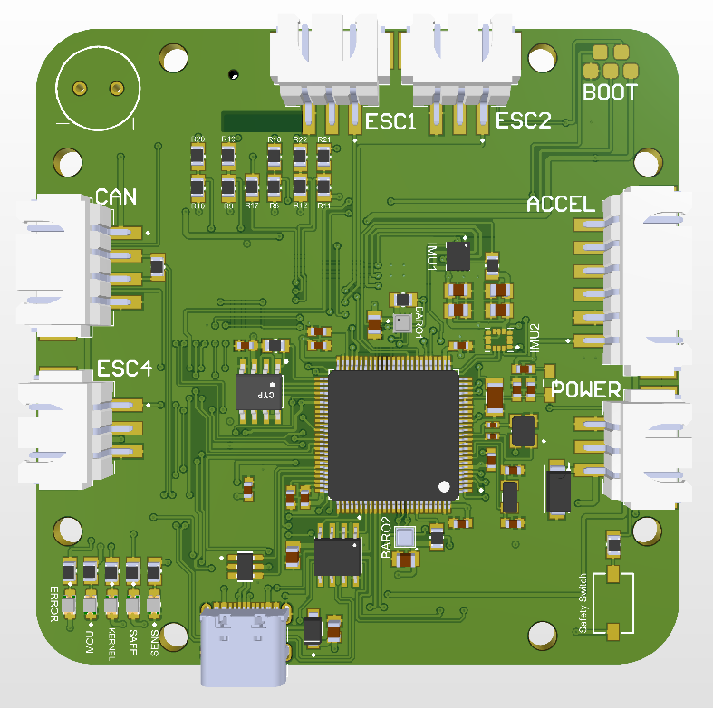

# Rev A – FMU V1.0 (Altium Designer)

First revision of the flight controller, designed in **Altium Designer** with a hierarchical schematic (5 sheets). Fabricated and brought up; issues found during bring-up are tracked in the repository [Issues](https://github.com/Traiserdinger/Custom-PX4-Flight-Controller/issues).

## Hardware

| Block | Parts |
|---|---|
| MCU | STM32H743VIT6, 24 MHz HSE, 32.768 kHz LSE |
| IMU (redundant) | ICM-42688-P (SPI1), ICM-42670-P (SPI2) |
| Barometer (redundant) | BMP390L, BMP581 (SPI3) |
| Power monitor | INA219 (I2C2) |
| Storage | microSD (4-bit SDMMC), FM25V05 F-RAM (SPI2) |
| Outputs | 4× motor + 4× aux PWM, buffered by SN74LVC244 |
| RC input | FlySky i-Bus, level-shifted by SN74LVC1T45 |
| Comms | USB-C (USBLC6-2SC6 ESD), CAN (SN65HVD230), GPS, telemetry, optical flow, ROS 2 uXRCE-DDS, FPGA SPI header |
| Power | AMS1117-3.3 (MCU rail), RT9193-3.3 low-noise LDO (sensor rail), SMAJ5.0A TVS |
| Misc | Safety switch, buzzer, status LEDs, SWD pads |

## Files

| Path | Content |
|---|---|
| `Trung Flight Controller.PrjPcb` | Altium project (open this) |
| `FMU_FMU`, `Sensor_FMU`, `SD_FMU`, `PWM_FMU`, `Connector_FMU` `.SchDoc` | Schematic sheets |
| `Trung PX4 Flight Controller PCB.PcbDoc` | PCB layout (4 layers) |
| `Library/` | Schematic and footprint libraries, 3D models |
| `Project Outputs for Trung Flight Controller/` | **Fabrication outputs:** Gerber (`*.gbr`), NC drill (`*.TXT`, `*.DRR`), BOM (`*.xlsx`), DRC and net status reports |
| `Project Logs for Trung Flight Controller/` | Altium ECO logs |

Related:

- Schematic PDF: [`docs/rev-a-v1.0/Schematic_V1.0.pdf`](../../docs/rev-a-v1.0/Schematic_V1.0.pdf)
- Photos and render: [`docs/rev-a-v1.0/images/`](../../docs/rev-a-v1.0/images)
- PX4 bootloader and firmware built for this board: [`firmware/rev-a-v1.0/`](../../firmware/rev-a-v1.0)
- Board STEP and enclosure: [`mechanical/3d-printed/`](../../mechanical/3d-printed)

## Opening the project

1. Open `Trung Flight Controller.PrjPcb` in Altium Designer.
2. If 3D models are missing, check *Preferences → Data Management → File-based Libraries* and add `Library/`.

Rev B (FMU V1.1) moved to OrCAD/Allegro: see [`../rev-b-v1.1`](../rev-b-v1.1).
