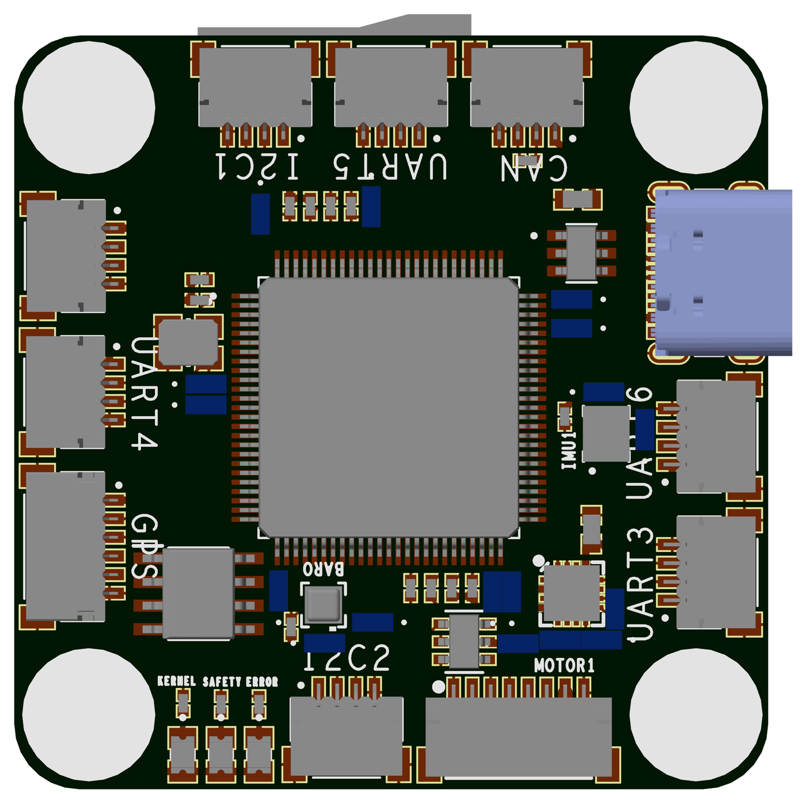
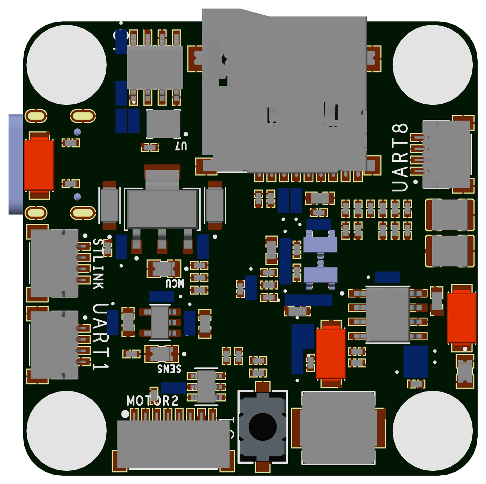

# Rev B – FMU V1.1 (OrCAD Capture CIS + Allegro PCB Editor 24.1)

Second revision of the flight controller. Schematic in **OrCAD Capture CIS 24.1** (hierarchical, 7 sheets), layout in **Allegro PCB Editor 24.1**.

> **Status:** layout complete (0 unconnected nets), **under design review, not fabricated yet.**
> Open findings, including two CRITICAL items (ESC connector pinout, buck input capacitor), are listed in [`docs/rev-b-v1.1/REVIEW_RevB.md`](../../docs/rev-b-v1.1/REVIEW_RevB.md) (Vietnamese).
> Gerber and NC drill files are intentionally **not** published for this revision.

| Top | Bottom |
|---|---|
|  |  |

## Board

| Item | Value |
|---|---|
| Size | 40.5 × 40.5 mm, 4× M3 grommet holes (Ø4.0 NPTH, 32.625 mm pitch) |
| Stackup | 6 layers, 1.6 mm, 1 oz: TOP / GND (L2) / SIGNAL (L3) / POWER (L4: `+5`, `+3.3_MCU`, `+3.3_SENS`) / GND (L5) / BOTTOM |
| Vias | 0.3 mm finished (0.35 mm drill), through |
| Parts | 151 (57 top, 93 bottom, 1 not placed: C56) |
| Passives | 0402 Samsung CL05 / UNI-ROYAL 0402WGF; 10 µF and bulk caps 0603 or larger |

## Hardware

| Block | Parts | Notes |
|---|---|---|
| MCU | STM32H743VIT6 (LQFP100), 24 MHz crystal Y2 | No LSE; RTC on LSI |
| IMU 1 | ICM-42670-P | SPI2, `IMU1_DRDY` |
| IMU 2 | BMI270 | SPI3, `IMU2_DRDY` |
| Barometer | BMP581 | SPI1 (shared with FRAM) |
| Magnetometer | HMC5883L | I2C2, `MAG_DRDY` |
| FRAM | FM25V05-G | SPI1 |
| Storage | microSD, 4-bit SDMMC, 22 Ω series | |
| Motor outputs | 8 outputs, 33 Ω series (R49–R56) + 2× USBLC6-4SC6 | M1–M4 on TIM1, M5–M8 on TIM4; bidirectional DShot capable |
| ESC connectors | 2× JST-SH 8-pin (MOTOR1 / MOTOR2) | `+VIN`, `CURR`, `UART7_RX` on MOTOR1 |
| CAN | TJA1051T/3 + 120 Ω | |
| USB | USB-C (Amphenol 10155435), USBLC6-2SC6 ESD | |
| Ports | UART1/3/4/5/6/8, GPS (UART2 + I2C1), I2C1, I2C2, CAN, LED strip/buzzer, ST-Link (SWD) | JST-SH |
| Power | TPS5430 buck (`+VIN` 3S–6S → 5.3 V) → SS34 OR-ing with USB → `+5`; AMS1117-3.3 → `+3.3_MCU`; RT9193-3.3 → `+3.3_SENS` (enabled by `SENS_PWR_EN`) | |
| Sensing | Battery voltage divider 10K/1K (`BAT1_V_DIV` = 11), analog current from ESC, VDD 5 V and VBUS sense | |

## Files

| Path | Content | Tool |
|---|---|---|
| `schematic/TRUNG PX4 FLIGHT CONTROL.DSN` | Schematic design (includes design cache) | Capture CIS 24.1 |
| `schematic/Trung PX4 Flight Control.opj` | Capture project | Capture CIS 24.1 |
| `pcb/FMU_V1.1_RevB.brd` | Board database | Allegro PCB Editor 24.1 |
| `pcb/TrungPX4Mapper.map` | 3D model mapping for 3D Canvas / STEP export | Allegro |
| `pcb/footprints/motor_pad_3x5.*` | Custom footprint | Allegro |
| `netlist/pst*.dat` | Netlist exported from Capture (2026-11-18) | text |
| `bom/FMU_V1.1_RevB_BOM.csv` | Grouped BOM with CIS part numbers and MPN; *Note* column flags missing or mismatched MPNs | CSV |
| `bom/FMU_V1.1_RevB_PartList.csv` | One line per part, with placement side | CSV |
| `reports/` | Allegro reports generated 2026-11-20: DRC, unconnected pins, unplaced/placed components, dangling lines and vias, cross-section, dynamic shape status | text |
| `step/FMU_V1.1_RevB.step.zip` | Assembled board 3D model (STEP AP214, mm). 0402 capacitors appear as boxes (3D model not mapped) | any MCAD |

Documentation in [`docs/rev-b-v1.1/`](../../docs/rev-b-v1.1):

- [`FMU_V1.1_RevB_Schematic.pdf`](../../docs/rev-b-v1.1/FMU_V1.1_RevB_Schematic.pdf): full schematic, 7 sheets.
- [`layers/`](../../docs/rev-b-v1.1/layers): PNG plot of every artwork film, plus all films in one PDF (`layers/pdf/FMU_V1.1_RevB_Layers.pdf`).
- [`3d/`](../../docs/rev-b-v1.1/3d): renders from the STEP model.
- [`REVIEW_RevB.md`](../../docs/rev-b-v1.1/REVIEW_RevB.md): schematic and layout review.

## Opening the project

1. Copy `schematic/` and `pcb/` keeping the same parent folder, or point Capture to the board when using *PCB → Update/Open Board*.
2. Open `Trung PX4 Flight Control.opj` in Capture CIS 24.1. The design cache inside the `.DSN` contains all symbols, so the original `.OLB` libraries are not needed to view or print.
3. Open `pcb/FMU_V1.1_RevB.brd` in Allegro PCB Editor 24.1. Footprints and padstacks are stored in the board; the source footprint library is only needed to refresh symbols.
4. Part data (MPN) comes from a private CIS Access database that is not included; the resolved values are exported in `bom/`.
